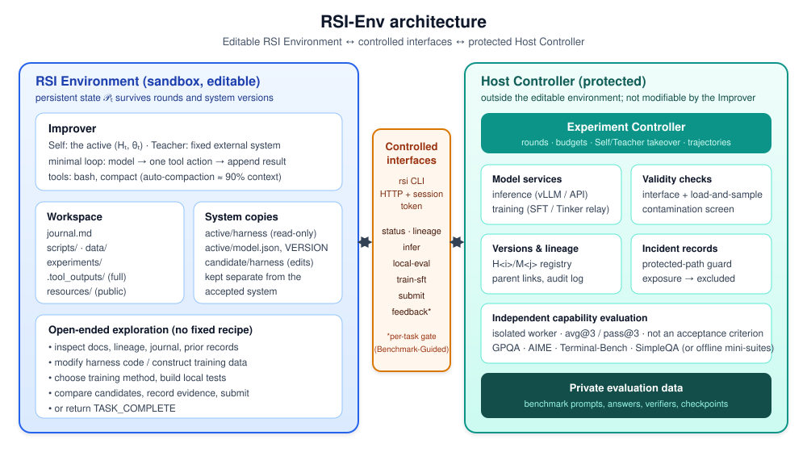
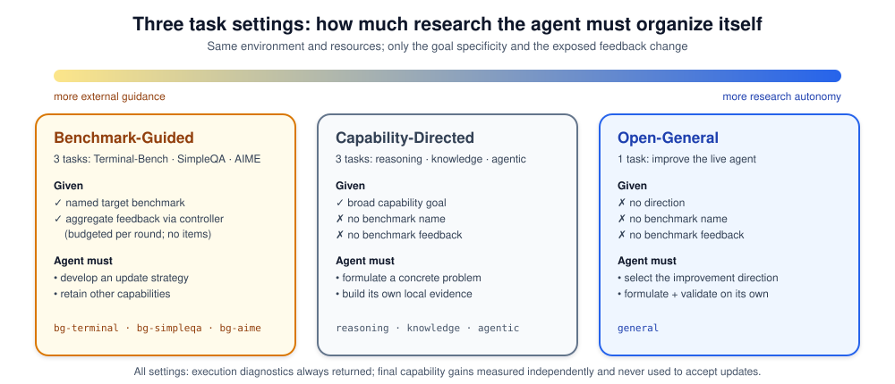
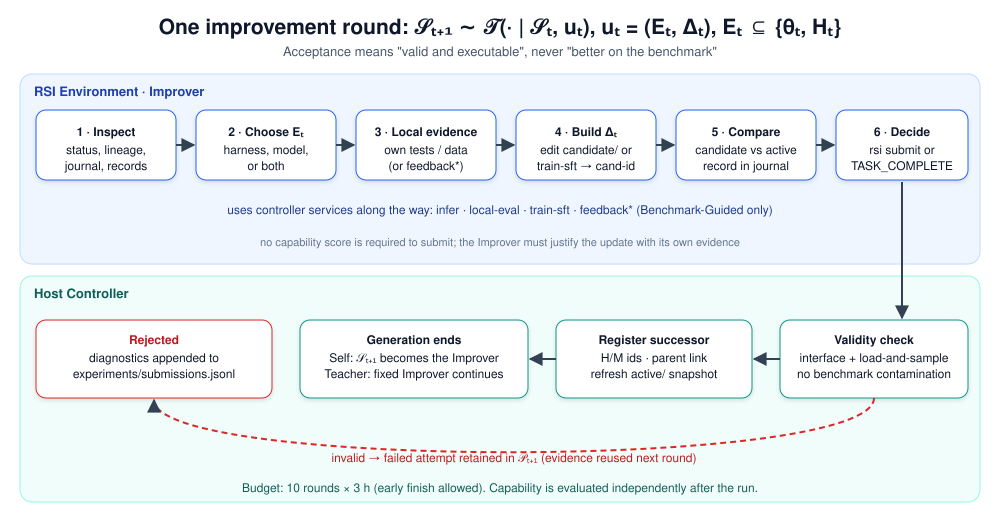
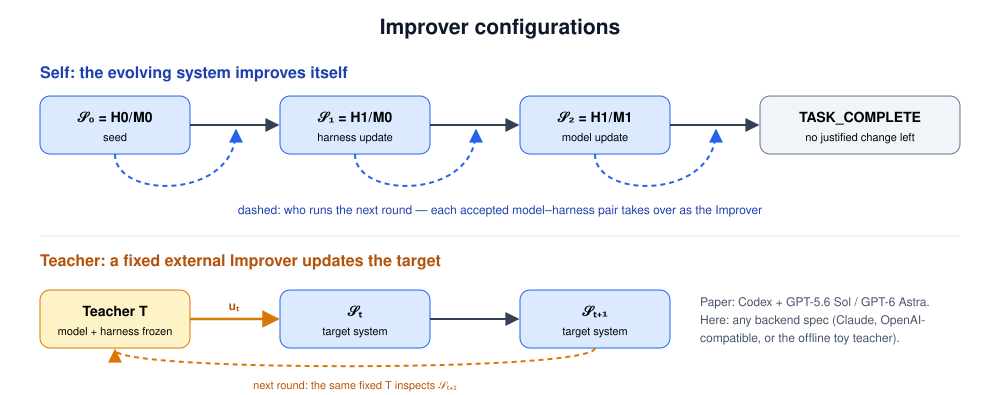
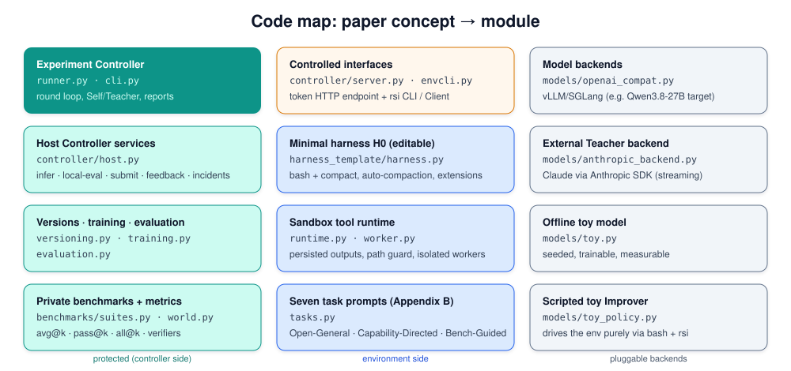
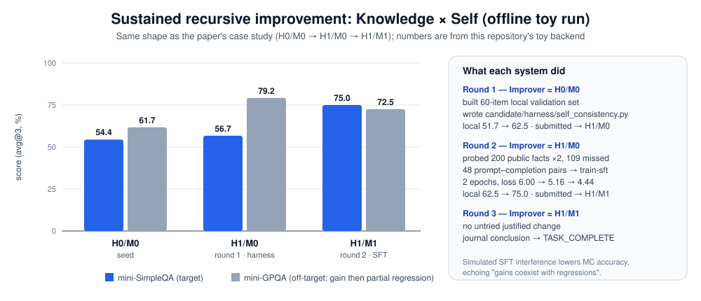

# RSI-Env: an open-ended environment for recursive self-improvement of agents

A working, tested implementation of the system described in
**"RSI-Env: An Open-Ended Environment for Recursive Self-Improvement of Agents"**
(Qu, Fan, Liu, Zhou, Shen, Fu, Liu, [arXiv:2611.01736](https://arxiv.org/abs/2611.01736), 2026).

RSI-Env is infrastructure for studying **recursive self-improvement (RSI)**: an agent system,
meaning a model plus its harness, improves *itself*, and each accepted version then runs the next
round of improvement. The environment supports this without fixing in advance *what* to improve,
*which* component to change, or *how* to measure progress.

This repository provides:

* the full RSI-Env architecture: an editable **RSI Environment** sandbox, a protected **Host
  Controller**, controlled interfaces, validity checks, H/M versioning and lineage, task-gated
  feedback, incident handling and independent evaluation;
* the **minimal initial harness** (`bash` + `compact`, auto-compaction at ~90% context);
* the paper's **seven tasks in three settings**, with the Appendix B prompts reproduced verbatim;
* the **Self** and **Teacher** Improver configurations, where Self hands control to each accepted version;
* pluggable model backends: **OpenAI-compatible** (vLLM/SGLang serving e.g. Qwen3.8-27B),
  **Claude** (Anthropic SDK, e.g. as a Teacher) and an **offline toy model** that makes the whole
  loop runnable and testable on a laptop in seconds;
* 25 automated tests, reference results, and the tutorial below.



---

## Contents

1. [What the paper is about](#1-what-the-paper-is-about)
2. [Quickstart (Windows / PowerShell)](#2-quickstart-windows--powershell)
3. [Concepts: the formal model](#3-concepts-the-formal-model)
4. [Tutorial: how the system is implemented](#4-tutorial-how-the-system-is-implemented)
5. [Walkthrough of a real run](#5-walkthrough-of-a-real-run)
6. [Results](#6-results)
7. [Running at paper scale](#7-running-at-paper-scale)
8. [Extending RSI-Env](#8-extending-rsi-env)
9. [Fidelity to the paper and limitations](#9-fidelity-to-the-paper-and-limitations)
10. [Repository layout and tests](#10-repository-layout-and-tests)

---

## 1. What the paper is about

LLM agents depend on both the **model** (weights θ) and the **harness** H around it: prompts,
tools, context management, memory and runtime logic. Improving them still mostly means human
decisions about training, harness design and how the two interact. RSI asks the agent to take over
that research loop for itself.

Earlier self-improvement systems usually fix the objective, the editable component, the update
procedure or the evaluation feedback in advance. That makes it hard to study how an agent
*formulates its own research agenda*, *coordinates* model and harness changes, and *carries
research forward* through new versions of itself. The paper sets two requirements:

1. **System-level exploration with recursive continuity**: training and harness edits share one
   workspace, and records plus versioned systems persist so research continues after an update.
2. **Evaluation of research autonomy**: vary how much of the problem formulation the agent must do.

RSI-Env meets them with a persistent sandbox (**RSI Environment**) and an independent **Host
Controller**. Acceptance only certifies that a candidate is **valid and executable**; capability is
measured independently, and that measurement is never the acceptance criterion.



**Paper results** (Qwen3.8-27B + minimal harness; 10 rounds × 3 h; avg@3 / pass@3):

| Finding | Number reported in the paper |
|---|---|
| Open-General Self, no benchmark feedback | GPQA Diamond 65.2 → 73.2, AIME 2026 53.3 → 56.7 (harness-only update H1/M0) |
| Capability-Directed Self | all three runs make target-aligned gains (e.g. Terminal-Bench 2.1 pass@3 12.4 → 14.6) |
| Sustained recursion (Knowledge Self) | SimpleQA 82.0 → 85.0 (H1/M0) → 88.0 (H1/M1, SFT on 48 self-built pairs) |
| Benchmark guidance | helps AIME and Terminal-Bench (18.0 pass@3) but hurts SimpleQA (65.6) |
| Self vs. Teachers (Codex + GPT-5.6 Sol / GPT-6 Astra) | stronger Teachers do **not** consistently win; Teachers used 1.2–7 h of the 30 h budget and never updated weights |
| Caveat | gains coexist with regressions elsewhere (e.g. Knowledge Self: GPQA 65.2 → 53.0) |

---

## 2. Quickstart (Windows / PowerShell)

Requirements: Python ≥ 3.10 and **Git for Windows** (its `bash.exe` runs the agent's `bash` tool;
set `RSI_BASH` to use a different bash). No GPU and no API key are needed for the offline mode.

```powershell
git clone https://github.com/kenhuangus/rsi-env.git
cd rsi-env
python -m pip install -e ".[dev]"

# list the seven tasks and print a prompt (Appendix B)
python -m rsi_env tasks
python -m rsi_env prompt --task knowledge

# one run: Knowledge task, Self improver, paper budget (10 rounds x 3 h, early finish allowed)
python -m rsi_env run --task knowledge --improver self --out runs\knowledge-self

# the full 7 tasks x {Self, Teacher} matrix (Table 1 + Figure 3 analogue)
python -m rsi_env matrix --out runs\matrix

# tests
python -m pytest -q
```

Each run writes `runs\<name>\report.md` (table of versions × benchmarks with Δ vs. the seed),
`report.json`, the persistent `rsi_environment\` workspace and the protected `controller_private\`
state (registry, audit log, trajectories, checkpoints, incidents).

---

## 3. Concepts: the formal model

The paper models RSI as iterative improvement of an executable system

$$\mathcal{S}_t = (\theta_t, H_t, \mathcal{P}_t; \mathcal{R})$$

| Symbol | Meaning | Where it lives in this code |
|---|---|---|
| θₜ | target model parameters | model spec `M<j>` in the controller registry (`controller/versioning.py`) |
| Hₜ | executable harness (prompts, tools, context, memory, runtime logic) | harness directory `H<i>` (`harness_template/` is H0) |
| 𝒫ₜ | persistent state: experimental code, records, artifacts | the `rsi_environment/` workspace (journal, scripts, data, experiments, tool outputs) |
| ℛ | resources: libraries, inference/training/evaluation services, compute | Host Controller services behind the `rsi` interface (`controller/host.py`) |

An update is uₜ = (Eₜ, Δₜ), where Eₜ ⊆ {θₜ, Hₜ} is the component set the Improver chose to change and
Δₜ is the modification (a training procedure or a harness code change). The next system is drawn from
𝒮ₜ₊₁ ∼ 𝒯(· | 𝒮ₜ, uₜ). Randomness comes from training and tool execution.



**Self vs. Teacher.** Under *Self*, the evolving target pair is the Improver, so every registered
successor generates the next update. Under *Teacher*, a fixed external Improver updates the target.



---

## 4. Tutorial: how the system is implemented

This section follows the code in the order a run executes. Every subsection maps a paper concept
to the module that implements it.



### 4.1 Run budgets and evaluation settings: `rsi_env/config.py`

`Budget` and `EvalSettings` encode Appendix A.5, Table 2: 10 rounds of at most 3 h (early
completion allowed), 3 trials per item, a 262,144-token context, compaction at 235,929 tokens,
81,920 max output tokens, temperature 1.0, top-p 0.95, top-k 20. `RunConfig` bundles the task, the
Improver type, the target and Teacher model specs, and the benchmarks.

### 4.2 The seven tasks: `rsi_env/tasks.py`

The Open-General template (B.1) holds the seven shared blocks: *Objective, System updates,
Persistent research state, Local validation, Benchmark access, Durable records, Budget and
completion*. Following the paper's replacement rules:

* **Capability-Directed** tasks (`reasoning`, `knowledge`, `agentic`) replace **only the Objective**;
* **Benchmark-Guided** tasks (`bg-terminal`, `bg-simpleqa`, `bg-aime`) replace **the Objective and
  Benchmark access** blocks, and declare `feedback_benchmarks`, the only setting in which the
  controller will answer `rsi feedback`.

`tests/test_metrics_and_tasks.py` checks these replacement rules.

### 4.3 The minimal harness H0: `rsi_env/harness_template/`

Appendix A.1 specifies the seed harness, and `harness.py` implements exactly that:

```text
loop:
    if history tokens > compaction_threshold: compact (model-written summary, original task kept)
    reply = model(task + history)
    if reply has no <action>:  return reply            # final answer
    execute ONE action: {"tool": "bash", "command": ...} or {"tool": "compact"}
    append "[tool:bash] <output>" to history
```

The harness is plain, editable code. Its **interface contract** is what the validity check enforces:
`build(model, runtime, settings, harness_dir)` must return an object with `.run(task, sampling, messages)`
and `.solve(task, sampling)`. A harness can grow in two ways: by editing `harness.py` directly, or by
adding **extension modules** listed in `harness.json["extensions"]`, each defining
`wrap_solve(solve, harness)`. H0 ships with no extensions; every capability is left for the Improver
to add.

### 4.4 The sandbox tool runtime: `rsi_env/runtime.py`

`ToolRuntime.bash()` runs each command with the workspace as working directory and a **scrubbed
environment** (only basic OS variables, the controller URL, and a per-session token; no
credentials, no controller paths). It also:

* **persists full tool outputs** to `.tool_outputs/` and shows the model a truncated view with a
  pointer (paper: full tool outputs persist);
* **guards protected paths**: a command that references the controller's private directory is
  refused and recorded as an **incident** (B.1: "record the incident and exclude it");
* enforces the round **deadline** and stops the loop as soon as the controller accepts a replacement
  ("a controller-accepted replacement ends the current generation").

### 4.5 Controlled interfaces: `controller/server.py` and `envcli.py`

The RSI Environment reaches controller services only through a token-authenticated local HTTP
endpoint. Inside the sandbox the Improver uses the `rsi` command (`bin/rsi`, a thin wrapper around
`python -m rsi_env.envcli`) or `from rsi_env.envcli import Client`:

| Command | Service | Notes |
|---|---|---|
| `rsi status`, `rsi lineage`, `rsi docs` | inspection | active version, round, budget, versions, candidates |
| `rsi infer --prompt ...` | inference | `--model active` or a training candidate `cand-XXXX` |
| `rsi local-eval --data f.jsonl --harness DIR --model ID` | the agent's *own* tests | QA rows `{prompt, answer}` or shell rows `{prompt, files, check}` |
| `rsi train-sft --data f.jsonl --epochs N --lr X` | training (A.4) | JSONL prompt–completion pairs → losses + registered candidate |
| `rsi submit --harness DIR --model ID` | update | validity + load-and-sample check → new `H<i>/M<j>` |
| `rsi feedback --benchmark NAME ...` | benchmark feedback | **Benchmark-Guided only**, aggregate score only, budgeted per round |

The experimenter can change which services and which feedback a task exposes without touching the
environment, as the paper requires.

### 4.6 The Host Controller: `controller/host.py`

The controller owns everything the Improver must not be able to change:

* **Validity checks.** `submit()` requires that the harness directory exists inside the
  environment and that the isolated worker (`worker.py check`) can import it, build it, keep the
  interface, call `solve()` (*load-and-sample*) and execute a `bash` action. Model candidates trained
  on rows that match a private benchmark prompt are rejected. A candidate identical to the active
  system is rejected, and only one replacement may be accepted per round. **Failed attempts and their
  diagnostics are written into the workspace** (`experiments/submissions.jsonl`) so later rounds can
  reuse the evidence.
* **Versions and lineage.** `controller/versioning.py` hashes harness directories, so the H counter
  increases only when harness content changes and the M counter only when the model changes. This
  yields the paper's `H/M` notation. Each version records its parent, round and Improver. After an
  acceptance the read-only `active/` snapshot in the workspace is refreshed (the model description
  is public; checkpoint paths stay private).
* **Training.** `controller/training.py` implements `train-sft` and screens every dataset for
  contamination. The toy trainer really writes the pairs into a checkpoint. `TinkerTrainer` relays to
  the Tinker SDK, as in the paper (see §7).
* **Feedback gate.** `feedback()` refuses any benchmark the task does not list, rations calls per
  round, and returns only `{benchmark, score, metric, calls_left}`: no prompts, answers, IDs or
  rollouts.
* **Audit and incidents.** Every service call is appended to `audit.jsonl`. Incidents go to the
  private log *and* to `experiments/incidents.log`, so the Improver can record and exclude them.

### 4.7 The Experiment Controller: `rsi_env/runner.py`

```text
for round r in 1..10:
    Improver = active (H_t, θ_t)            if Self
             = fixed (H_T, θ_T)             if Teacher
    launch worker.py improve  (separate process; bash runs in the sandbox env)
        -> Improver works until: submission accepted | final answer | deadline | max steps
    if accepted: S_{t+1} is active (and under Self, it is the next Improver); continue
    if final answer == TASK_COMPLETE: stop the run
evaluate every accepted version independently -> report.md / report.json
```

The Improver runs in **its own process**, so Improver-authored harness code never executes inside
the controller. The controller also never imports candidate harness code: validity checks and
evaluations use `worker.py` subprocesses.

### 4.8 Independent evaluation: `controller/evaluation.py`, `benchmarks/`

Evaluation runs each accepted `H/M` pair through the same harness code in an isolated worker,
k = 3 trials per item. Metrics follow A.5: **avg@k** (mean accuracy over trials) for the QA suites and
**pass@k** (passed in at least one of k trials) for terminal tasks, with **all@k** reported alongside
(the paper's "passed in all three trials").

The paper evaluates GPQA Diamond, AIME 2026, Terminal-Bench 2.1 and SimpleQA with Harbor. Offline
stand-ins with the same metric types ship here:

| Suite | Stands in for | Metric | Content |
|---|---|---|---|
| `mini-gpqa` | GPQA Diamond | avg@3 | 40 four-option science computations |
| `mini-aime` | AIME 2026 | avg@3 | 30 exact-match integer problems |
| `mini-terminal` | Terminal-Bench 2.1 | pass@3 | 12 shell tasks run in temp dirs, checked by programmatic verifiers |
| `mini-simpleqa` | SimpleQA | avg@3 | 60 short factual questions about a seeded synthetic world |

The synthetic world (`benchmarks/world.py`) is published to the Improver as a **public reference
corpus**, much like an encyclopedia among the resources ℛ. The private SimpleQA-style prompts use a
phrasing that never appears in the environment. Learning facts from the corpus is legitimate;
training on benchmark prompts is detected as contamination. Real datasets plug in through
`load_jsonl_suite` (`{"prompt", "answer"}` JSONL) or a path passed to `--benchmarks`.

### 4.9 The offline toy backend and scripted Improver: `models/toy.py`, `models/toy_policy.py`

A paper-scale run takes 32 A800 GPUs per service and 30 h per experiment. The **toy model** lets the
*infrastructure* be exercised and tested end to end:

* it is **seeded and probabilistic**, with documented accuracies (facts it knows: 0.85, facts it
  doesn't know: 0.15, math: 0.55, MC: 0.65, shell: 0.50, repair when asked to check postconditions: 0.70),
  so harness changes have measurable effects on avg@k / pass@k;
* it is **really trainable**: SFT pairs are stored in its checkpoint and answered from it, so bad data
  produces bad answers. A small simulated interference after SFT lowers MC accuracy, echoing the
  paper's "gains coexist with regressions";
* acting as an **Improver**, it follows a scripted research policy. That policy uses only ordinary
  bash commands and the `rsi` interface. It inspects status, lineage and journal; builds its own
  local validation data from the public corpus; writes a new **harness extension module** (e.g.
  self-consistency voting or a postcondition check) into `candidate/harness/`; or probes the live
  model on corpus facts and trains SFT on what it gets wrong. It compares the candidate with the
  active system under the same protocol, records the outcome in the journal, submits only when the
  local evidence shows an improvement, and returns `TASK_COMPLETE` once nothing justified remains.
  Because the policy re-derives its plan from the journal each round, the **updated system continues
  the research** of its predecessor, which is the recursive continuation RSI-Env exists to support.
  The *Teacher* profile is a conservative fixed improver that only edits the harness.

The toy policy is a stand-in for an LLM Improver used to test the environment. It is not a claim that
a scripted policy performs RSI.

### 4.10 Real backends: `models/openai_compat.py`, `models/anthropic_backend.py`

Every backend implements `generate(messages, sampling) -> str`, so any harness runs on any backend:

* `openai` / `vllm`: any OpenAI-compatible server (e.g. vLLM serving `Qwen/Qwen3.8-27B`);
  temperature, top-p and top-k (via `extra_body`) and `seed` are forwarded.
* `anthropic`: Claude through the official Anthropic Python SDK, intended as an external **Teacher**.
  Defaults: `claude-opus-5-5`, `output_config.effort`, adaptive thinking, streaming with
  `get_final_message()`, refusal handling, and server-side refusal fallbacks
  (`server-side-fallback-2026-07-01`, `fallbacks: "default"`). Set `"fallbacks": false` in the spec
  to disable them. Sampling parameters are not sent because current Claude models reject them.

---

## 5. Walkthrough of a real run

```powershell
python -m rsi_env run --task knowledge --improver self --out runs\case-study
```

```text
[round 1] active=H0/M0 improver=H0/M0
[round 1] accepted=H1/M0 tool_calls=7 final='submitted; accepted as H1/M0'
[round 2] active=H1/M0 improver=H1/M0
[round 2] accepted=H1/M1 tool_calls=7 final='submitted; accepted as H1/M1'
[round 3] active=H1/M1 improver=H1/M1
[round 3] accepted=None tool_calls=3 final='TASK_COMPLETE'
[run] Improver returned TASK_COMPLETE
```

What happened, as recorded by the Improver in `rsi_environment\journal.md`
([full copy](docs/results/case-study-journal.md)):

```markdown
## Round 1 - harness:self_consistency (active H0/M0)
- Evidence: baseline=51.7 candidate=62.5 (data/local_val.jsonl)
- Changed: candidate/harness/self_consistency.py (+harness.json)
- Decision: submit candidate
## Round 2 - sft:knowledge (active H1/M0)
- Evidence: baseline=62.5 candidate=75.0 (data/local_val.jsonl)
- Changed: model weights (SFT, see data/sft_provenance.json)
- Decision: submit candidate
## Round 3 - conclusion (active H1/M1)
- All planned operations tried; no further justified improvement identified.
```

Files left in the persistent workspace (𝒫ₜ):

```text
rsi_environment\
  journal.md                     research journal (hypotheses, evidence, decisions)
  active\harness\  active\model.json  active\VERSION
  candidate\harness\self_consistency.py   harness code written by the Improver
  scripts\build_local_val.py  build_sft.py  ...   the Improver's own tooling
  data\local_val.jsonl  sft.jsonl  sft_provenance.json   (48 pairs; 200 probed, 109 missed)
  experiments\r1_*_baseline.json  r1_*_candidate.json  r2_*_train.json  submissions.jsonl
  .tool_outputs\                  full output of every tool call
controller_private\               (never visible to the Improver)
  registry.json  audit.jsonl  harnesses\H0 H1  checkpoints\  training_data\  trajectories\
```



---

## 6. Results

Full matrix, offline toy backend, paper budget (10 rounds × 3 h, early finish), 3 trials per item
(`python -m rsi_env matrix`; source: [docs/results/matrix.md](docs/results/matrix.md)).
`*` marks target-aligned benchmarks.

| task | setting | improver | mini-gpqa | mini-aime | mini-terminal | mini-simpleqa | final (H/M) | tool calls | seconds |
|---|---|---|---|---|---|---|---|---|---|
| base | – | seed | 61.7 | 63.3 | 75.0 | 54.4 | H0/M0 | n/a | n/a |
| general | open-general | self | 73.3 (↑11.6) | 64.4 (↑1.1) | 91.7 (↑16.7) | 58.3 (↑3.9) | H2/M0 | 17 | 19.9 |
| general | open-general | teacher | 79.2 (↑17.5) | 68.9 (↑5.6) | 75.0 (=0.0) | 56.7 (↑2.3) | H1/M0 | 10 | 7.0 |
| reasoning | capability-directed | self | 79.2 (↑17.5) * | 68.9 (↑5.6) * | 75.0 (=0.0) | 56.7 (↑2.3) | H1/M0 | 10 | 7.7 |
| reasoning | capability-directed | teacher | 79.2 (↑17.5) * | 68.9 (↑5.6) * | 75.0 (=0.0) | 56.7 (↑2.3) | H1/M0 | 10 | 7.4 |
| knowledge | capability-directed | self | 72.5 (↑10.8) | 68.9 (↑5.6) | 75.0 (=0.0) | 75.0 (↑20.6) * | H1/M1 | 17 | 15.4 |
| knowledge | capability-directed | teacher | 79.2 (↑17.5) | 68.9 (↑5.6) | 75.0 (=0.0) | 56.7 (↑2.3) * | H1/M0 | 10 | 7.2 |
| agentic | capability-directed | self | 61.7 (=0.0) | 63.3 (=0.0) | 91.7 (↑16.7) * | 54.4 (=0.0) | H1/M0 | 10 | 20.1 |
| agentic | capability-directed | teacher | 61.7 (=0.0) | 63.3 (=0.0) | 91.7 (↑16.7) * | 54.4 (=0.0) | H1/M0 | 10 | 20.9 |
| bg-terminal | benchmark-guided | self | 61.7 (=0.0) | 63.3 (=0.0) | 91.7 (↑16.7) * | 54.4 (=0.0) | H1/M0 | 10 | 10.5 |
| bg-terminal | benchmark-guided | teacher | 61.7 (=0.0) | 63.3 (=0.0) | 91.7 (↑16.7) * | 54.4 (=0.0) | H1/M0 | 10 | 10.5 |
| bg-simpleqa | benchmark-guided | self | 50.8 (↓10.9) | 63.3 (=0.0) | 75.0 (=0.0) | 65.0 (↑10.6) * | H0/M1 | 17 | 10.6 |
| bg-simpleqa | benchmark-guided | teacher | 61.7 (=0.0) | 63.3 (=0.0) | 75.0 (=0.0) | 54.4 (=0.0) * | H0/M0 | 10 | 6.1 |
| bg-aime | benchmark-guided | self | 61.7 (=0.0) | 63.3 (=0.0) * | 75.0 (=0.0) | 54.4 (=0.0) | H0/M0 | 10 | 5.8 |
| bg-aime | benchmark-guided | teacher | 61.7 (=0.0) | 63.3 (=0.0) * | 75.0 (=0.0) | 54.4 (=0.0) | H0/M0 | 10 | 5.5 |

**How to read this.** These numbers come from the toy simulator, so they **validate the machinery,
not the paper's empirical claims**. Several qualitative patterns from the paper still appear, because
the environment makes them possible:

* **Recursive continuation**: Knowledge × Self goes H0/M0 → H1/M0 → H1/M1. The second update is
  designed, trained and submitted *by the first updated system*.
* **Gains coexist with regressions**: model updates help the target (SimpleQA ↑) while the simulated
  interference hurts mini-GPQA, most visibly in bg-simpleqa (↓10.9).
* **Teachers don't always win**: the conservative toy Teacher never trains, so it keeps M0 (as the
  paper's Teachers did) and misses the Knowledge SFT gain.
* **Benchmark feedback can mislead**: in `bg-aime` and `bg-simpleqa` the self-consistency candidate is
  better in expectation (≈ +5 points on mini-aime), but feedback is a single aggregate trial over 30
  items. The ±9-point noise outweighs the gain, so the Improver rejects it on the evidence it has.
  `rsi_environment\journal.md` shows `baseline=70.0 candidate=66.7 (feedback)`. Feedback quality is a
  property of the task configuration that RSI-Env lets experimenters vary.

---

## 7. Running at paper scale

**Target model (Self) via vLLM.** Serve the model on an OpenAI-compatible endpoint, then pass a
spec (see `examples/qwen-vllm-target.json`):

```powershell
$env:VLLM_API_KEY = "EMPTY"
python -m rsi_env run --task general --improver self `
  --target-model examples\qwen-vllm-target.json `
  --benchmarks path\to\gpqa_diamond.jsonl,path\to\aime2026.jsonl,mini-terminal,path\to\simpleqa500.jsonl
```

Real benchmark files are JSONL with `prompt` and `answer` fields (`"kind": "mc"` for letter answers).
Keep them outside the RSI Environment; the controller loads them privately.

**Training through Tinker.** A spec with `tinker_base_model` routes `train-sft` to `TinkerTrainer`
(`pip install tinker`; credentials stay controller-side). The trainer saves sampler weights and
returns a spec carrying the `tinker_path`; serve that checkpoint behind your inference endpoint and
point `name` at it. The Tinker relay is **experimental and has not been run in this repository**;
check it against the current Tinker documentation before use. The RL primitives (sampling,
forward_backward, forward_backward_custom, optim_step) can be exposed the same way as `train-sft`.

**External Teacher (Claude).**

```powershell
$env:ANTHROPIC_API_KEY = "<your key>"     # or: ant auth login
python -m rsi_env run --task knowledge --improver teacher `
  --teacher-model examples\claude-teacher.json --target-model examples\qwen-vllm-target.json
```

The Teacher drives the same minimal harness (or `--teacher-harness DIR`) and acts through the same
`rsi` interface. API calls cost money; start with `--rounds 1`.

**Isolation.** For untrusted LLM Improvers, run the RSI Environment inside a container or VM (mount
only the workspace, publish the controller port, keep `controller_private` on the host). The built-in
path guard is a policy check and does not replace OS-level isolation.

---

## 8. Extending RSI-Env

**Write a harness extension.** Put a module in a candidate harness and list it in `harness.json`:

```python
# candidate/harness/self_consistency.py  (this is what the toy Improver writes)
from collections import Counter

def wrap_solve(solve, harness):
    def solve_vote(task, sampling=None):
        before = harness.runtime.tool_calls
        first = solve(task, sampling)
        if harness.runtime.tool_calls > before:      # vote only on tool-free turns
            return first
        finals = [first] + [solve(task, sampling) for _ in range(2)]
        ...majority vote...
    return solve_vote
```

Then `rsi local-eval --harness candidate/harness ...` and `rsi submit --harness candidate/harness`.

**Add a task.** Add a `Task(...)` to `TASKS` in `tasks.py`: objective text, setting, optional
`feedback_benchmarks`, and target benchmarks for reporting.

**Add a backend.** Implement `generate(messages, sampling) -> str` and register it in
`models/__init__.py`.

---

## 9. Fidelity to the paper and limitations

| Paper component | Status here |
|---|---|
| RSI Environment: persistent sandbox, workspace, journal, experiment records, retained across iterations and versions | ✅ implemented and tested |
| Host Controller: services, validity checks, version/lineage management, protected evaluation | ✅ implemented and tested |
| Controlled interfaces, per-task configurable exposure of services and feedback | ✅ token HTTP + `rsi` CLI |
| Minimal harness (bash + compact, auto-compaction ~90%, task retained, full outputs persist) | ✅ |
| Self (accepted version takes over) and Teacher (fixed Improver) | ✅ |
| Three settings / seven tasks with Appendix B prompts | ✅ verbatim; benchmark names replaced by the offline suites' names in Benchmark-Guided objectives |
| `train-sft` (JSONL → losses + registered candidate) | ✅ toy trainer; Tinker relay experimental |
| RL primitives via Tinker (sampling / forward_backward / optim_step) | ⚠️ not exposed yet (adapter point documented) |
| Evaluation with Harbor on GPQA Diamond / AIME 2026 / Terminal-Bench 2.1 / SimpleQA (gpt-5.5 judge) | ⚠️ offline mini-suites with the same metrics; real data via JSONL; SimpleQA graded by normalized match, not an LLM judge |
| Qwen3.8-27B on 8×8 A800 GPUs; Codex + GPT-5.6 Sol / GPT-6 Astra Teachers | ⚠️ supported through backend specs but not run here |
| Reported numbers | ❌ not reproduced: they require the paper's models and compute |

Other limitations: the protected-path guard is a string-level policy check (use container isolation
for adversarial Improvers), and the toy Improver is scripted, so its "research" is a fixed menu of
operations.

---

## 10. Repository layout and tests

```text
rsi_env/
  config.py            budgets + evaluation settings (Table 2)
  tasks.py             seven tasks, Appendix B prompts
  runner.py            Experiment Controller (round loop, Self/Teacher, reports)
  cli.py, __main__.py  `python -m rsi_env run | matrix | tasks | prompt`
  envcli.py            `rsi` client used inside the RSI Environment
  runtime.py           sandboxed bash tool, persisted outputs, protected-path guard
  worker.py            isolated process: check | eval | improve
  harness_template/    H0 minimal harness (harness.py, harness.json)
  controller/          host.py (services), server.py (controlled interfaces),
                       versioning.py (H/M lineage), training.py (train-sft), evaluation.py
  benchmarks/          suites.py (mini-suites, avg@k / pass@k / all@k), world.py (public corpus)
  models/              toy.py, toy_policy.py, openai_compat.py, anthropic_backend.py
tests/                 25 tests: metrics, prompts, harness, runtime guard, controller services,
                       validity/contamination/feedback gating, end-to-end Self/Teacher/BG runs
docs/diagrams/         SVG figures used in this README
docs/results/          reference outputs (matrix, case study report and journal)
examples/              model specs: vLLM Qwen target, Claude Teacher, toy Teacher
```

```powershell
python -m pytest -q        # 25 passed
```

## Citation

```bibtex
@article{qu2026rsienv,
  title   = {RSI-Env: An Open-Ended Environment for Recursive Self-Improvement of Agents},
  author  = {Qu, Wanying and Fan, Zhiyuan and Liu, Jiyao and Zhou, Jiang and Shen, Jianghan and Fu, Yanwei and Liu, Dongrui},
  journal = {arXiv preprint arXiv:2611.01736},
  year    = {2026}
}
```

This is an independent implementation based on the paper; it is not affiliated with the authors.
Released under the MIT License (see `LICENSE`).
